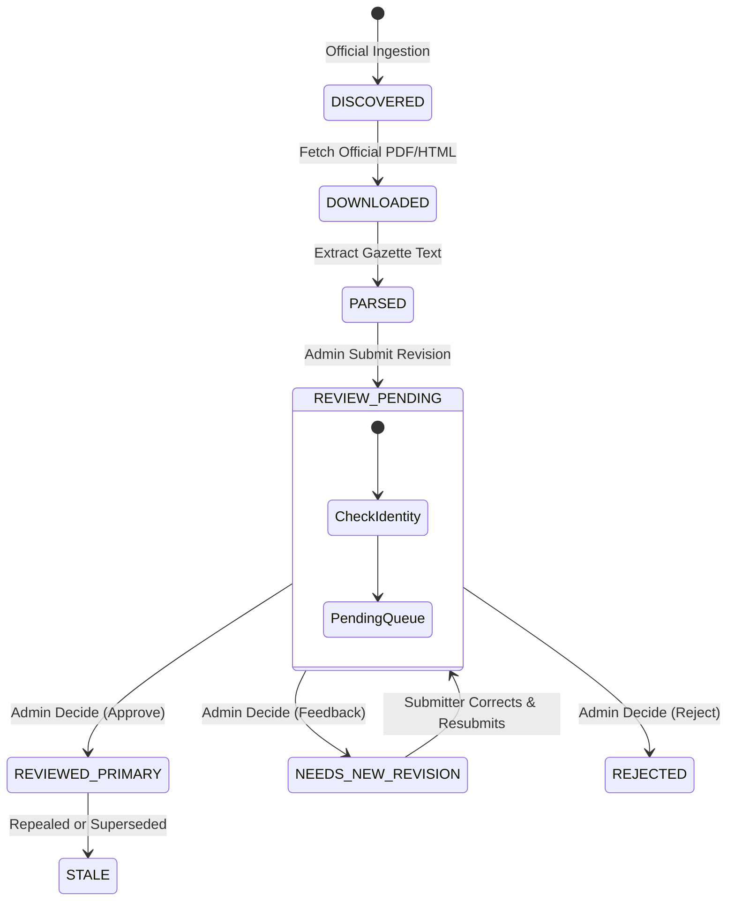

# Phase 4 Authority Review and Administration Architecture

## 1. Overview and Core Invariants

The CaseSeva Phase 4 authority review system establishes an immutable boundary between untrusted statutory candidates and verified primary law. Under no circumstance may any model inference, scraper, citizen input, or automated test bypass independent human administrative review.

This document formally specifies the architectural separation between:
1. **Tier A: Development & Administrative CLI** (`scripts/review_cli.py`, admin commands)
2. **Tier B: Backend Authority Review Service & API** (`backend/services/authority_review.py`, `backend/routes/authorities.py`)
3. **Tier C: Future Authenticated Reviewer/Admin Web Interface** (Upcoming production reviewer portal)

All three tiers interact with the identical underlying domain invariants, models, and cryptographic receipt structures.

---

## 2. Tier Architectural Separation

```
+------------------------------------+    +------------------------------------+
|  Tier A: Admin / Developer CLI     |    | Tier C: Future Admin Web UI        |
|  - Headless batch review           |    | - Visual diffing & passage view    |
|  - CI diagnostic checks            |    | - Browser-based JWT authentication |
|  - Direct service or HTTP client   |    | - Calls Tier B REST endpoints      |
+-----------------+------------------+    +-----------------+------------------+
                  |                                         |
                  +--------------------+--------------------+
                                       |
                                       v
         +-------------------------------------------------------------+
         | Tier B: Backend Authority Review Service & REST API         |
         | `AuthorityReview` service & `/api/admin/authorities`        |
         +-------------------------------------------------------------+
                                       |
                +----------------------+----------------------+
                |                                             |
                v                                             v
+-------------------------------+             +-------------------------------+
| Cryptographic Identity & Data |             | Immutable Audit Receipts      |
| - Exact passage boundaries    |             | - `legal_authority_reviews`   |
| - Official domain/URL checks  |             | - `legal_review_submissions`  |
| - Content and raw SHA-256     |             | - Source digests & signatures |
+-------------------------------+             +-------------------------------+
```

### 2.1 Tier A: Development / Admin CLI
- **Purpose**: Diagnostic, bootstrap, CI/CD validation, and headless administrative operations.
- **Access Control**: Operates either locally with direct access to local administrative identity databases (`identity.json`) or via administrative API tokens.
- **Scope**: Used by engineering and legal-ops specialists for regression verification, revision continuation testing, and initial corpus bootstrap.
- **Constraints**: Cannot forge reviewer IDs, cannot bypass identity validation, and cannot approve proposals submitted by the same actor.

### 2.2 Tier B: Backend Authority Review Service (`backend/services/authority_review.py`)
- **Single Source of Truth**: All review transitions MUST pass through `AuthorityReview.decide()` and `AuthorityReview.submit()`.
- **Enforced Security Controls**:
  - **Authentication & RBAC**: Verifies persistent administrator credentials in `accounts_db` (`role == 'admin'`).
  - **Separation of Duties**: Submitter cannot approve their own proposed authority (`submission['actor'] != reviewer['id']`).
  - **Optimistic Concurrency Control**: Validates `expected_version == source['version_id']`, preventing stale review overwrites.
  - **Mandatory Review Rationale**: Requires non-empty reviewer rationale (`note.strip()`).
  - **Statutory Identity Verification**: Verifies official URLs, HTTPS scheme, host whitelist, title exact presence, section boundaries, and temporal interval validity via `corpus.validate_identity()`.
  - **Immutable Receipts**: Creates tamper-evident receipt records in `legal_authority_reviews` with deterministic `authority_digest`.

### 2.3 Tier C: Future Authenticated Reviewer/Admin Web Page
- **Purpose**: Rich graphical workspace for appointed legal advocates and administrative reviewers to inspect, compare, and adjudicate authority candidates.
- **Implementation Rule**: MUST NOT create an alternative review path or separate validation rules. The web page connects exclusively to Tier B endpoints (`/api/admin/authorities`).
- **Required Capabilities Preserved in Web UI**:
  1. **Strict Authentication**: Admin session authentication via secure HTTP-only session cookies / bearer tokens.
  2. **Pending Review Queue**: Displays pending candidates from `GET /api/admin/authorities` with urgency, domain, and submission lineage.
  3. **Exact Passage Visualizer**: Highlights exact passage substring (`official_text[section_start:section_end] == quote`) side-by-side with official gazette text.
  4. **Official Source Provenance**: Displays official document source (`official_url`, `final_url`), download timestamps, and TLS host validation.
  5. **Cryptographic Hashes & Provenance**: Shows raw content hash and structured `content_hash` (SHA-256).
  6. **Lineage Tracking**: Displays parent revision link (`parent_revision`), revision requests (`revision_request_id`), and submission history.
  7. **Temporal & Amendment Evidence**: Displays `effective_from`, `effective_until`, and linked amendment source IDs (`temporal_source_ids`).
  8. **Automated Warning Flags**: Renders pre-review automated validation checks (e.g. section numbering format, date interval conflicts).
  9. **Reviewer Rationale**: Mandates typed legal rationale (`note`) before submitting decision.
  10. **Full Review State Transitions**:
      - `REVIEWED_PRIMARY`: Approved into verified corpus as primary authority.
      - `NEEDS_NEW_REVISION`: Returned to submitter with specific correction feedback (`revision_status: REVISION_REQUESTED`).
      - `REJECTED`: Permanently excluded from statutory corpus.
      - `STALE`: Deprecated by subsequent superseding enactment.
  11. **Immutable Review Receipts & History**: Fetches and renders historical receipts from `GET /api/admin/authorities/{source_id}/history`.

---

## 3. Review State Machine



---

## 4. Preservation of Pre-existing Review Records

During this audit, no legal authority record was approved or modified:
- Baseline Database SHA-256: `b96220116ac40a01b4f96e6b620edc7eebfa35d39d11dfb33b677b9bf67716c3`
- Baseline Identity SHA-256: `bd055fe4bd996aba38a243fbb3572f68646be7cd469e0382a3b57920a9a15b17`
- Record 1 proposal status: Untouched and awaiting independent authorized review.
